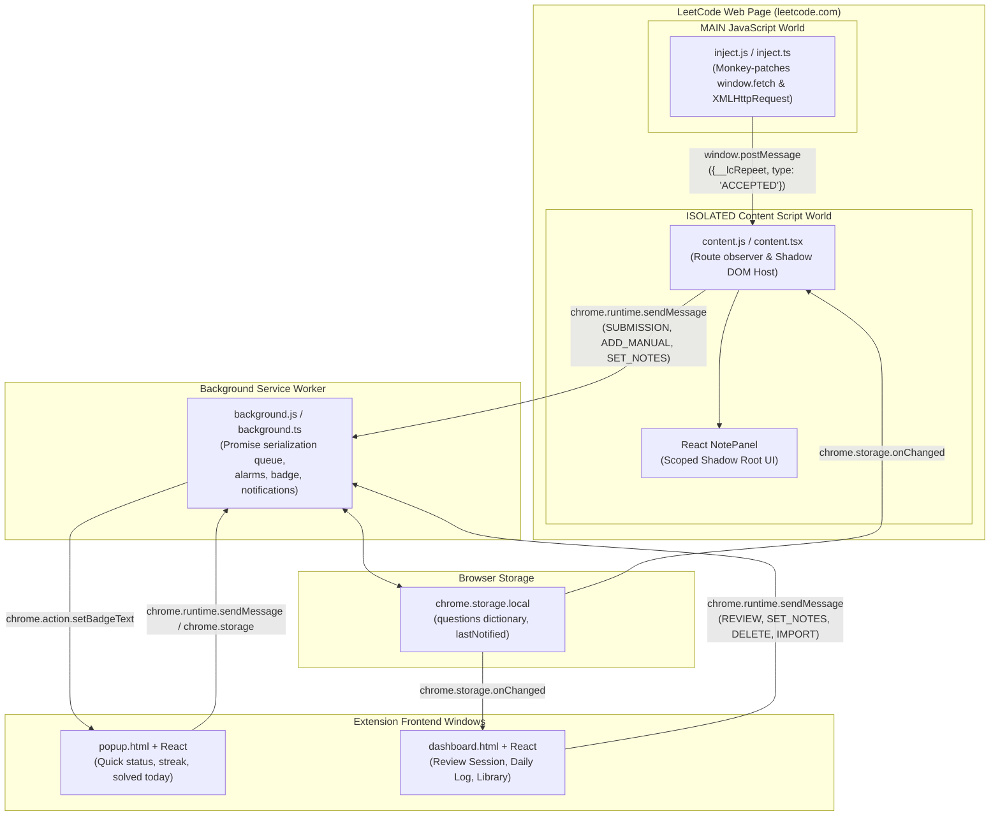
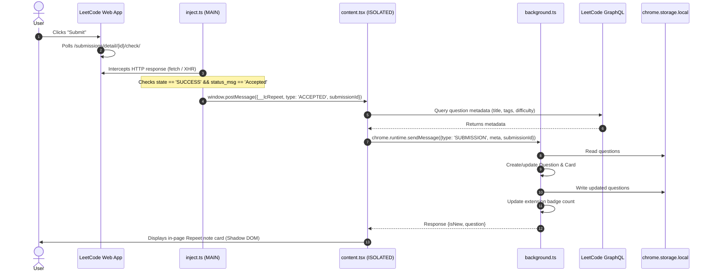
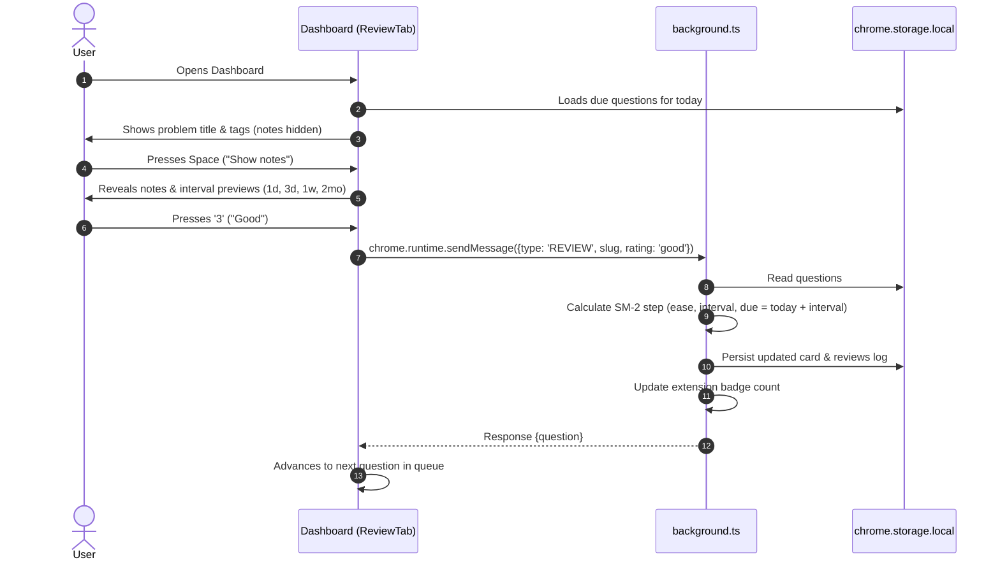

# Specification Document: Repeet (LeetCode Revision Deck)

## 1. Executive Summary & System Purpose

**Repeet** is a local-first Google Chrome extension (Manifest V3) designed for software engineers practicing data structures and algorithms on [LeetCode](https://leetcode.com). 

Solving a problem once is rarely sufficient for long-term retention. Repeet solves this by:
1. **Zero-friction passive capture**: Passively monitoring solution submissions on `leetcode.com`. When a submission is judged **Accepted**, it automatically records the problem metadata and prompts the user to jot down reflection notes (patterns, edge cases, intuition).
2. **Spaced Repetition System (SRS)**: Scheduling future reviews using an adapted SuperMemo-2 (SM-2) algorithm, resurfacing problems right before memory decays.
3. **Daily Revision Workflow**: Providing a full-featured dashboard with hotkey-driven active recall sessions, a 26-week activity heatmap, and a searchable problem library with JSON backup export/import.
4. **Privacy & Offline First**: Running 100% locally on the user's browser using `chrome.storage.local`. No external backend, telemetry, or account registration is required; the only outbound network request is to LeetCode's public GraphQL API for problem metadata.

---

## 2. System Architecture (Manifest V3)

The extension comprises five communicating execution environments operating under Chrome's Manifest V3 security boundaries:



### Component Roles & Execution Contexts

| Component | Execution World / Context | Lifecycle | Primary Responsibility |
| :--- | :--- | :--- | :--- |
| **`inject.ts`** | `MAIN` world (page context) | Runs at `document_start` on `leetcode.com/*` | Intercepts page network traffic to detect Accepted submissions without interfering with LeetCode. |
| **`content.tsx`** | `ISOLATED` world | Runs at `document_idle` on `leetcode.com/*` | Observes route changes, mounts Shadow DOM, receives messages from `inject.ts`, renders in-page note card. |
| **`background.ts`** | Background Service Worker | Event-driven (wakes on messages/alarms) | Serializes storage writes, manages SM-2 state transitions, triggers alarms, updates toolbar badge and daily notification. |
| **`popup`** | Browser Action Popup | Ephemeral (opened via toolbar icon) | Quick overview: due count, streak, questions solved today, shortcut to review dashboard. |
| **`dashboard`** | Full-page Extension Tab (`dashboard.html`) | Persistent while open | Main application hub: active recall review deck, 26-week activity heatmap, question library CRUD, backup import/export. |

---

## 3. Data Model & Storage Schema

All extension data is stored under `chrome.storage.local`.

### 3.1 Storage Layout

```typescript
interface StorageSchema {
  questions: Record<string, Question>;
  lastNotified?: string; // YYYY-MM-DD date key
}
```

### 3.2 Question Entity

Each problem is keyed by its unique URL slug (e.g., `'two-sum'`, `'trapping-rain-water'`).

```typescript
interface Question {
  slug: string;                      // URL identifier, e.g. "two-sum"
  title: string;                     // "Two Sum"
  frontendId: string | null;         // "1"
  difficulty: 'Easy' | 'Medium' | 'Hard' | 'Unknown';
  tags: string[];                    // ["Array", "Hash Table"]
  url: string;                       // "https://leetcode.com/problems/two-sum/"
  notes: string;                     // User's markdown/text notes
  addedAt: string;                   // "YYYY-MM-DD" date string
  solves: SolveRecord[];             // Historical solves / submissions
  reviews: ReviewRecord[];           // Historical review ratings
  card: Card;                        // Spaced repetition state
}

interface SolveRecord {
  id: string;                        // LeetCode numeric submission ID or "manual-<timestamp>"
  date: string;                      // "YYYY-MM-DD"
  ts: number;                        // Unix epoch milliseconds
  lang: string;                      // e.g. "python3", "cpp"
  runtime: string;                   // e.g. "45 ms"
  manual?: boolean;                  // True if added via Library/Sidebar
}

interface ReviewRecord {
  date: string;                      // "YYYY-MM-DD"
  ts: number;                        // Unix epoch milliseconds
  rating: Rating;                    // 'again' | 'hard' | 'good' | 'easy'
}
```

### 3.3 Card Entity (SRS State)

```typescript
interface Card {
  ease: number;                      // Easiness factor (SM-2, default 2.5, min 1.3)
  interval: number;                  // Days until next scheduled review (max 365)
  reps: number;                      // Consecutive successful repetitions
  lapses: number;                    // Times the card was failed/forgotten ('again')
  due: string;                       // Next due date: "YYYY-MM-DD"
  lastReviewed: string | null;       // "YYYY-MM-DD" or null if unreviewed
}
```

---

## 4. Spaced Repetition Algorithm (SM-2 Variant)

Repeet implements an adapted version of the SuperMemo-2 (SM-2) algorithm optimized for algorithmic problem-solving.

### 4.1 Card Initialization
When a problem is first solved or manually added on day $T$:
- $\text{ease} = 2.5$
- $\text{interval} = 1$ (first review is always scheduled for tomorrow)
- $\text{reps} = 0$
- $\text{lapses} = 0$
- $\text{due} = T + 1\text{ day}$
- $\text{lastReviewed} = \text{null}$

### 4.2 Rating Options & Transitions

| Rating | Semantic Meaning | Ease Adjustment | Interval Formula | Reps & Lapses |
| :--- | :--- | :--- | :--- | :--- |
| **`again`** | Forgotten / couldn't solve | $\max(1.3, \text{ease} - 0.20)$ | $\text{interval} = 1$ | $\text{lapses} += 1$, $\text{reps} = 0$ |
| **`hard`** | Solved with great difficulty | $\max(1.3, \text{ease} - 0.15)$ | $\max(\text{interval} + 1, \text{round}(\text{interval} \times 1.2))$ | $\text{reps} += 1$ |
| **`good`** | Solved with standard recall | Unchanged | If $\text{reps} = 0$: $3$<br/>Else: $\max(\text{interval} + 1, \text{round}(\text{interval} \times \text{ease}))$ | $\text{reps} += 1$ |
| **`easy`** | Trivial / immediate recall | $\text{ease} + 0.15$ | If $\text{reps} = 0$: $6$<br/>Else: $\max(\text{interval} + 2, \text{round}(\text{interval} \times \text{ease} \times 1.3))$ | $\text{reps} += 1$ |

*Constraints:*
- $\text{ease}$ is clamped to a minimum of $1.3$ and formatted to 2 decimal places.
- $\text{interval}$ is capped at $\text{MAX\_INTERVAL} = 365$ days.
- $\text{due} = \text{currentDate} + \text{interval}$.

### 4.3 Intra-Session Relearning Queue
When a user rates a card as **Again** during a live review session:
1. The rating and card updates are committed to storage immediately.
2. The card is flagged with `relearn: true` and appended to the tail of the current review session queue.
3. When it reappears in the same session, the user is presented with a 2-button choice:
   - **"Still fuzzy"** (Hot-key `1`): Keeps the card in the learning queue for another repeat.
   - **"Got it"** (Hot-key `2`): Completes the session for this card without re-mutating the schedule.

---

## 5. Subsystem Deep-Dive

### 5.1 Submission Interception (`inject.ts` & `content.tsx`)

#### Why Injection into MAIN World is Required
Chrome extension content scripts run in an `ISOLATED` world. They share the DOM with the web page but have isolated JavaScript execution environments. Thus, patching `window.fetch` inside a standard content script does not intercept network calls initiated by LeetCode's client scripts.

To overcome this, `manifest.json` injects `inject.js` into `"world": "MAIN"` at `document_start`.

#### The Interception Mechanism
When a user clicks "Submit" on LeetCode:
1. LeetCode sends the submission to its backend and receives a numeric ID (e.g. `1234567890`).
2. LeetCode's page polls `/submissions/detail/<id>/check/` until evaluation completes.
3. `inject.ts` intercepts both `window.fetch` and `XMLHttpRequest.prototype.open` matching the regex:
   ```regex
   /\/submissions\/detail\/(\d+)\/check\/?(\?|$)/
   ```
4. Only numeric IDs are matched (test case runs use prefixed IDs like `runcode_123` and are filtered out).
5. When the response JSON contains:
   ```json
   { "state": "SUCCESS", "status_msg": "Accepted" }
   ```
6. A deduplication guard (`Set<string> seen`) prevents multiple events for the same submission ID.
7. A cross-world message is dispatched:
   ```javascript
   window.postMessage({
     __lcRepeet: true,
     type: 'ACCEPTED',
     submissionId: id,
     lang: data.pretty_lang || data.lang || '',
     runtime: data.status_runtime || ''
   }, location.origin);
   ```

#### Content Script Handling & In-Page Shadow DOM
1. `content.tsx` listens for the `message` event and validates `origin` and `__lcRepeet === true`.
2. It parses the problem slug from `window.location.pathname` (`/problems/<slug>/`).
3. Fetches GraphQL metadata (or uses cache) from LeetCode.
4. Sends `SUBMISSION` message to the background service worker.
5. Displays the Repeet Slide-out Panel mounted in a dedicated **Shadow DOM host** (`#lc-repeet-host`).
   - Shadow DOM prevents LeetCode's CSS frameworks (Tailwind, Monaco editor styles) from altering Repeet's styles, and prevents Repeet's styles from leaking into LeetCode.
   - Keyboard events (`keydown`, `keyup`, `keypress`) inside the textarea are prevented from propagating to the document (`stopPropagation()`), ensuring LeetCode's page shortcuts (like editor commands) do not trigger while typing notes.
   - 30-second auto-close timer dismisses the card automatically if untouched.
6. A slim permanent vertical "Repeet" button is pinned to the right viewport edge for manual access on any problem page. Route changes in LeetCode's SPA are detected via a 700ms polling interval.

### 5.2 Background Service Worker (`background.ts`)

#### Write Serialization
Chrome storage writes are asynchronous. If two submissions finish concurrently, or if a user saves notes while an automated update runs, race conditions could corrupt data.

`background.ts` guards all writes through a promise chaining queue:
```typescript
let chain = Promise.resolve();
const serial = <T>(fn: () => Promise<T>): Promise<T> => {
  const p = chain.then(fn);
  chain = p.catch(() => {});
  return p;
};
```

#### Message Protocol
The background service worker handles the following RPC messages:
- **`SUBMISSION`**: Upserts a question, appends a new solve record, refreshes metadata.
- **`ADD_MANUAL`**: Adds a question by metadata and notes, assigns an initial `manual-<timestamp>` solve.
- **`SET_NOTES`**: Updates notes for a specific slug.
- **`REVIEW`**: Applies SM-2 rating calculation, logs review history, updates next due date.
- **`DELETE`**: Deletes a problem from the deck.
- **`IMPORT`**: Validates and merges an external JSON backup into the current deck.

#### Background Alarms, Badges & Daily Nudge
- **Periodic Alarm**: Runs every 60 minutes via `chrome.alarms.create('tick', { delayInMinutes: 1, periodInMinutes: 60 })`.
- **Badge**: Evaluates `LCA.dueList(questions, today).length`. Displays due count in blue (`#3550F5`), or clears badge if 0.
- **Daily Notification**: If hour $\ge 8$ AM, due questions exist, and `lastNotified !== today`: triggers a Chrome notification reminding the user to revise.

### 5.3 Extension Frontend Applications

#### 1. Action Popup (`popup`)
- Opens instantly on toolbar icon click.
- Displays:
  - Header with due count or deck status.
  - Active streak badge.
  - Quick list of problems solved today with difficulty pill and LeetCode link.
  - Primary button to launch review session in dashboard.
  - Links to Daily Log and Library.

#### 2. Dashboard (`dashboard`)
The dashboard is a full-featured single-page application offering three tabs:

##### Tab 1: Review
- Implements active recall methodology:
  1. Shows the problem title, difficulty, topic tags, solve history count.
  2. Prompts user: *"Say the approach and the complexity out loud first. Then check your notes."*
  3. Clicking "Show notes" (or pressing `Space`) reveals the notes card.
  4. User rates their memory: **Again** (`1`), **Hard** (`2`), **Good** (`3`), **Easy** (`4`).
  5. Next interval preview is dynamically calculated and displayed on each button (e.g. `1d`, `3d`, `1w`, `2mo`).
  6. Notes can be edited live and auto-save after 700ms debounce.
  7. Visual progress bar tracks session completion.

##### Tab 2: Daily Log
- **26-Week Activity Heatmap**: Inspired by GitHub's contribution graph. Displays a 7x26 grid mapping daily volume of solves and reviews with 5 intensity shades (`l0` to `l4`).
- **Activity Timeline**: Groups questions solved and reviewed per day in reverse chronological order, with "New" vs "Solved again" markers.

##### Tab 3: Library
- Full directory of all saved questions.
- Search filter: live search across title, frontend ID, tags, and note content.
- Filter dropdown: All, Easy, Medium, Hard.
- Sort dropdown: Due soonest, Recently added, Title.
- **Add by Link/Slug**: Paste any LeetCode problem URL or slug; queries GraphQL and immediately schedules card.
- **Accordion Row**: Expand to view/edit notes, inspect stats (interval, ease, solve count, review count), or delete problem.
- **Backup & Restore**: Export full JSON backup or import an existing backup file.

---

## 6. Sequence Diagrams

### 6.1 Solution Submission to Deck Flow



### 6.2 Review Session Rating Flow



---

## 7. Migration to TypeScript & React

### 7.1 Motivation
- **Type Safety**: Complex data structures (`Question`, `Card`, `SolveRecord`, `ReviewRecord`) and inter-process messaging benefit from static typing and compile-time contract enforcement.
- **Declarative UI**: Replacing manual DOM manipulation (`document.createElement`, element trees) in the dashboard, popup, and content script with React components drastically improves maintainability, readability, and state synchronization.
- **Build Optimization**: Vite and esbuild provide instant HMR/watch builds and bundling for Manifest V3.

### 7.2 Module Mapping

| Original (Vanilla JS) | Modernized (TypeScript + React) | Details |
| :--- | :--- | :--- |
| `shared.js` | `src/shared/srs.ts`, `src/shared/date.ts`, `src/shared/query.ts`, `src/shared/leetcode.ts` | Pure typed utility modules |
| `background.js` | `src/background/index.ts` | Fully typed service worker with serialized message handlers |
| `inject.js` | `src/content/inject.ts` | Standalone MAIN world injection bundle |
| `content.js` | `src/content/index.tsx`, `src/content/NotePanel.tsx` | React 18 component mounted into Shadow Root |
| `popup.html`, `popup.js`, `popup.css` | `src/popup/App.tsx`, `src/popup/main.tsx` | Modern React 18 Popup application |
| `dashboard.html`, `dashboard.js`, `dashboard.css` | `src/dashboard/App.tsx`, `ReviewTab.tsx`, `DailyLogTab.tsx`, `LibraryTab.tsx` | Modern React 18 Dashboard application |
| `ui.js` | React JSX Components | Replaced by idiomatic React elements |
